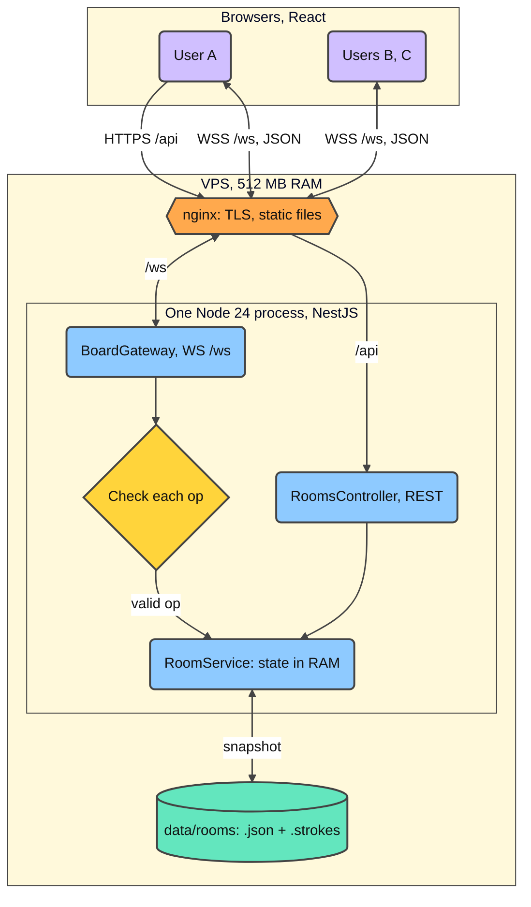
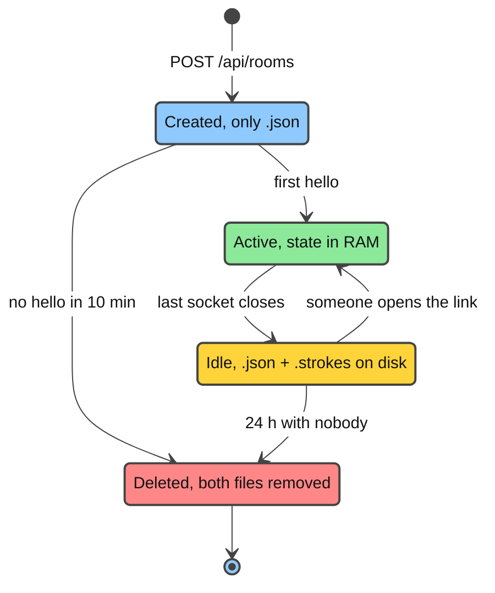
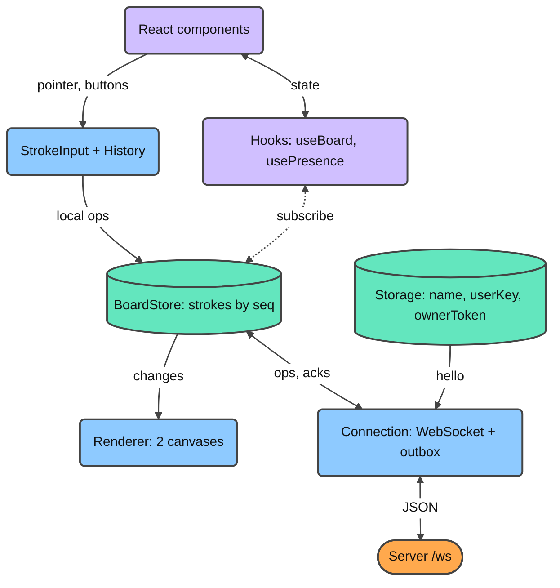
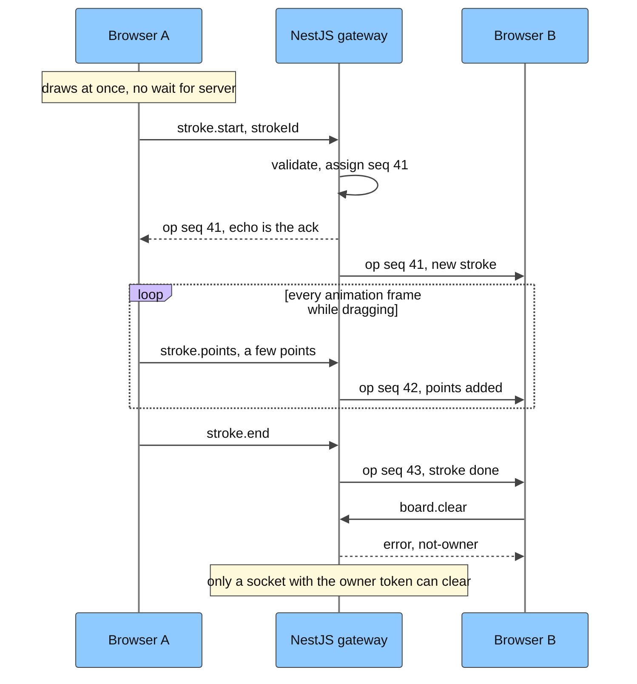
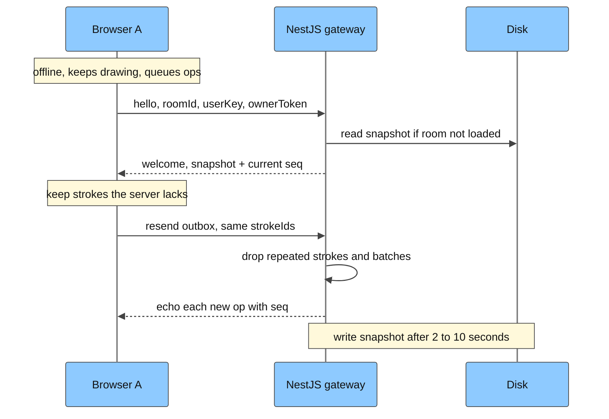
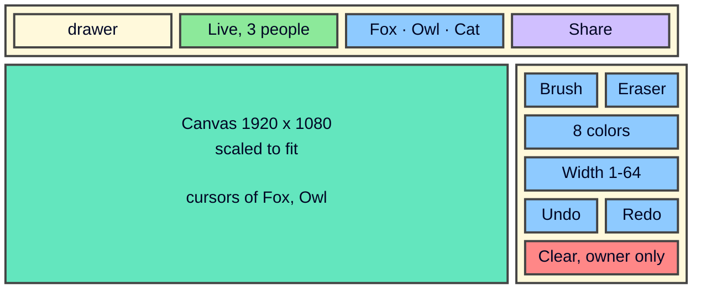
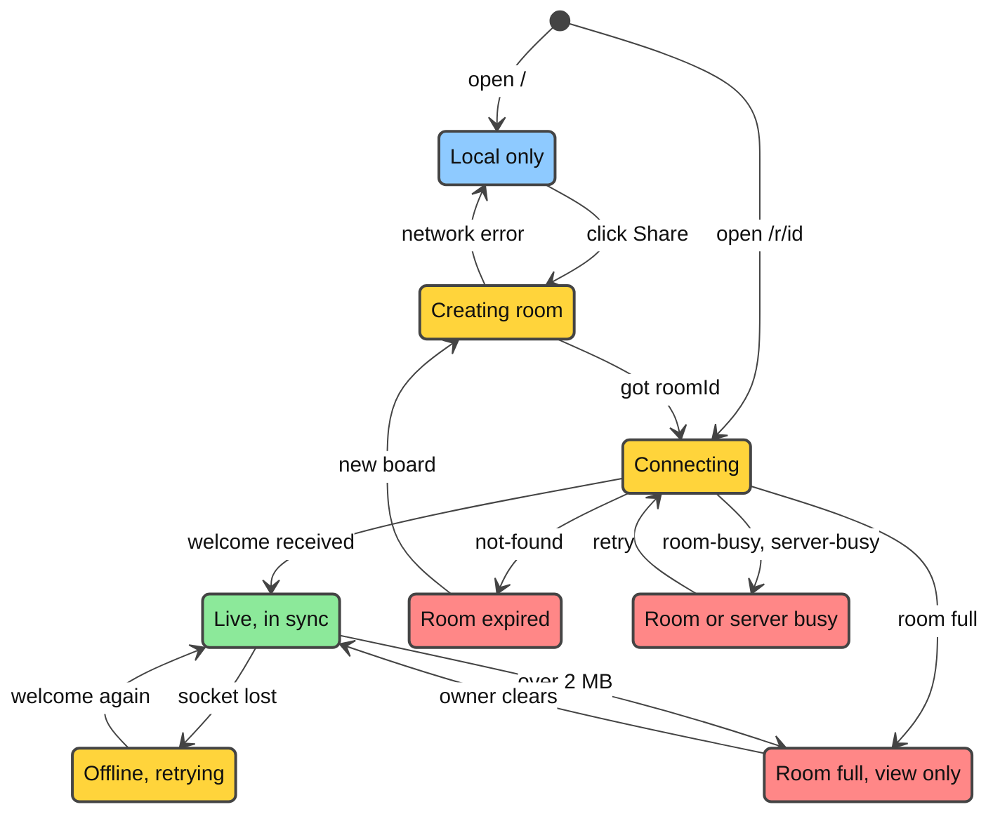
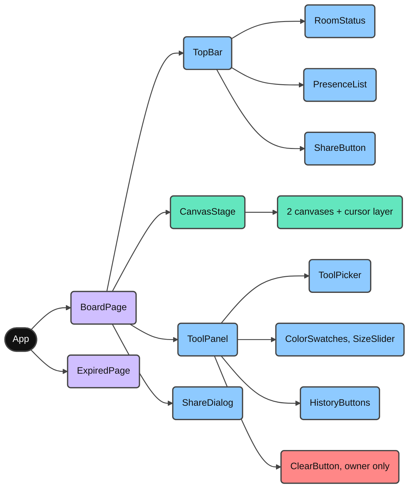

# drawer MVP design

- Status: approved by the owner on 2026-10-17 (backend option B).
- Scope and targets: `.vibekit/docs/PRD.md`. Project rules: `backbone.yml`. Glossary: `.vibekit/docs/CONTEXT.md`.
- Design presentation (private, Vietnamese): https://claude.ai/artifact/Y2m5ZLahU6vfHt8TChcUR2
- Applies to: `drawer-be` (this repo) and `../drawer-fe`.

This document is written so that a builder can plan and build the MVP without going back to the owner. Each decision is marked **owner** (the owner decided it) or **design** (a design call that the owner may still change). Everything in section 16 is left to the builder.

## 1. Intent

drawer is a drawing board in the browser, similar to kleki.com. A user draws at once, clicks Share, and sends the link. Everyone with the link draws on the same board and sees the other strokes while they are drawn. Nobody signs up.

The project is an MVP and a portfolio piece. The owner is learning React, so the frontend code must stay readable: plain React, few libraries, and a drawing engine that lives outside React state.

## 2. Goals, non-goals, anti-goals

Goals
- G1 Live multi-user drawing with the minimal tools: brush (color, width), eraser, undo/redo of own strokes, clear board by the room creator. (owner)
- G2 Late joiners see the full board. Concurrent strokes are never lost. (owner)
- G3 Temporary anonymous users with a random name and color, a presence list, and live cursors. (owner)
- G4 Acceptance targets: remote stroke visible in under 200 ms (p95); backend RSS under 200 MB at normal load. (owner)

Non-goals: accounts; storing drawings longer than 24 h without visitors; history and export; layers, text, shapes, fill, filters; zoom and pan; pen pressure; view-only links; mobile apps; more than one server process.

Anti-goals (the build fails even if it "works"):
- A stroke that one user drew disappears for another user without an undo or a clear.
- One room, one IP, or one slow client can push the VPS out of memory.
- A member who is not the room creator can clear the board, through the UI or through hand-made WebSocket messages.
- Pointer events re-render React components (the board must stay smooth at 60 fps).
- A heavy runtime dependency is added without reporting its memory cost.

## 3. Constraints

- Backend: NestJS 12 + TypeScript, Node 24, npm. WebSocket through `@nestjs/websockets` and `@nestjs/platform-ws` (12.1.3, checked on npm 2026-10-16), message validation with `class-validator` (0.15). (owner: NestJS; design: the packages)
- Frontend: React 19 + Vite 8 + TypeScript in `../drawer-fe`. (owner)
- Hosting: one VPS with 512 MB RAM that also runs background jobs; nginx in front with TLS. (owner)
- Storage: files on disk under `data/rooms/`; no database. (owner)
- Agent rule: the protected-path glob `**/*token*` blocks agent edits to files with "token" in the name. Name files `room-owner.guard.ts`, `owner-secret.ts`, and so on.

## 4. Decisions

| Decision | By | Notes |
| --- | --- | --- |
| Backend option B: server-ordered op log; no CRDT library | owner | Option A (Yjs + Hocuspocus) was rejected; see section 17 |
| Room state in files on disk, survives restarts and deploys | owner | One `.json` and one `.strokes` file per room |
| Room deleted 24 h after the last user leaves | owner | Unused new rooms are deleted after 10 min (design) |
| Live cursors | owner | Throttled to 10 Hz on the client |
| Only the room creator can clear the board | owner | Enforced by the server with an owner token |
| Targets 200 ms p95 and 200 MB RSS | owner | Checked in the M5 smoke run |
| WebSocket on the same port as REST, path `/ws` | design | Nest `WsAdapter` |
| JSON messages, envelope `{ event, data }` | design | Readable while learning; about 2x the size of a binary format, which is acceptable |
| Fixed board 1920 x 1080, scaled to fit the window | design | No zoom in the MVP |
| Eraser = a stroke in the background color | design | No layers or transparency in the MVP |
| Identity lives only in the browser | design | Random name and color; `userKey` per tab proves authorship of strokes |
| Ids from `node:crypto` (128-bit, base64url) instead of a nanoid package | design | One dependency fewer |

## 5. Architecture



One Node process runs the whole backend. nginx serves the `drawer-fe` build and proxies `/api/` and `/ws` to it.

Modules (`drawer-be/src/`)
- `rooms/`: `RoomsController` (`POST /api/rooms`), `RoomsService` (registry of rooms, quotas, timers), `RoomStore` (reads and writes the two files of a room).
- `board/`: `BoardGateway` (WebSocket `/ws`), DTOs for every client message, a permission check per op, `RoomService` (the loaded state of one room: seq, strokes, members, size).
- `sweeper/`: `SweeperService`, runs every 10 min (section 8.4).
- `health/`: `HealthController` (`GET /api/health`).
- `config/`: one typed config module on top of `@nestjs/config` (ports, data dir, limits, allowed origins). Feature code never reads `process.env`.

## 6. Protocol

### 6.1 Transport

- WebSocket at `/ws` on the same port as REST (Nest `WsAdapter` from `@nestjs/platform-ws`).
- Every message is JSON: `{ "event": "<name>", "data": { ... } }`. This is the default message shape of the Nest ws adapter and maps to `@SubscribeMessage('<name>')`.
- Maximum incoming message: 64 KiB (`ws` `maxPayload`). The largest client message is a point batch of about 1 KB.
- The first message on a socket must be `hello`, within 5 s; otherwise the server closes the socket.
- The server checks the `Origin` header of the upgrade request against the configured allowlist.
- Heartbeat: the server pings every 30 s and terminates a socket with no pong for 60 s.

### 6.2 Client to server

| Event | Data | Server rules |
| --- | --- | --- |
| `hello` | `{ roomId, userKey, ownerToken?, name, color }` | Once per socket (a second one is `bad-op`). Room must exist; fewer than 10 sockets in the room; admission (section 8.5). Owner if `sha256(ownerToken)` equals the stored hash (constant-time compare). The server gives the socket a random `memberId` (8 characters). |
| `stroke.start` | `{ strokeId, tool, color, width }` | `strokeId` already known: ignore. Room full: `error room-full`. Author = hash of the socket's `userKey`. |
| `stroke.points` | `{ strokeId, n, pts }` | Unknown `strokeId`: ignore. Only the author. `n` is the batch number, from 0. `n` below the expected number: ignore (repeat). `n` above it: `error bad-op`. Stroke already done: ignore. |
| `stroke.end` | `{ strokeId }` | Only the author. Idempotent. |
| `stroke.undo` | `{ strokeId }` | Only the author, else `error not-yours`. Sets `deleted = true`. Idempotent. |
| `stroke.redo` | `{ strokeId }` | Only the author. Sets `deleted = false`. Idempotent. |
| `board.clear` | `{}` | Owner only, else `error not-owner`. Marks every visible stroke deleted and keeps their ids as "last clear". |
| `board.restore` | `{}` | Owner only. Un-deletes the strokes of the last clear. |
| `cursor` | `{ x, y }` in board pixels, or `{ x: null, y: null }` when the pointer leaves the board | Relayed to the others; never stored; no seq. |

Every accepted board op (all rows except `hello` and `cursor`) gets the next room `seq`.

### 6.3 Server to client

| Event | Data | When |
| --- | --- | --- |
| `welcome` | `{ seq, full, you: { memberId, isOwner }, members, strokes }` | Reply to `hello`. `members`: `[{ memberId, name, color }]`. `strokes`: `[{ id, seq, tool, color, width, pts, batches, done, deleted, mine }]` in seq order; `mine` is true for strokes of this `userKey`. |
| `op` | `{ seq, by, kind, ...fields }` | Every accepted op goes to every socket in the room, including the sender. The sender treats its own echo as the acknowledgement. Exception: `stroke.points` goes to the others only. `by` is the sender's `memberId`, or `null` for ops the server makes itself. Fields: `stroke.start` `{ strokeId, tool, color, width }`; `stroke.points` `{ strokeId, n, pts }`; `stroke.end`, `stroke.undo`, `stroke.redo` `{ strokeId }`; `board.clear` and `board.restore` `{ strokeIds }`. |
| `presence` | `{ members }` | A member joins or leaves. |
| `cursor` | `{ memberId, x, y }` | Relayed cursor of another member. |
| `room` | `{ full }` | The room crosses the size cap in either direction. |
| `error` | `{ code, ref? }` | See 6.4. `ref` names the `strokeId` the error is about, when there is one. For `not-found`, `room-busy`, and `server-busy`, the server sends the error and then closes the socket. |

### 6.4 Error codes

| Code | Cause | Client behavior |
| --- | --- | --- |
| `not-found` | Room id unknown or expired | Close; show the expired page |
| `room-busy` | 10 sockets already in the room | Close; banner with a retry button |
| `server-busy` | Admission limit reached | Close; banner with a retry button |
| `room-full` | Room over 2 MB | Drop the pending stroke named in `ref`; disable drawing; the owner can still clear |
| `not-owner` | Clear or restore without the owner token | Should not happen from the UI; log it |
| `not-yours` | Undo or redo of another user's stroke | Should not happen from the UI; log it |
| `bad-op` | DTO validation failed or wrong batch number | Log it; the client resyncs on the next reconnect |
| `rate-limited` | Too many messages (section 8.5) | Slow down; the server closes the socket if it continues |

### 6.5 Validation limits

- `roomId`: 22 characters, base64url. `userKey`: 22 characters, base64url. `ownerToken`: 43 characters, base64url.
- `name`: 1-24 characters. `color`: `^#[0-9a-f]{6}$`. `tool`: `b` (brush) or `e` (eraser). `width`: integer 1-64.
- `pts`: flat integer array `[x, y, x, y, ...]`, even length, at most 128 numbers per batch, `0 <= x < 1920`, `0 <= y < 1080`. At most 5,000 points per stroke.

## 7. Data model

### 7.1 Server memory (loaded rooms only)

```text
Room   { id, seq, ownerHash, strokes: Map<strokeId, Stroke>, order: strokeId[] (by seq of stroke.start),
         sockets: Set<socket>, members: Map<memberId, { name, color }>, sizeBytes, lastClear: strokeId[] }
Stroke { id, seq, author: sha256(userKey), tool, color, width, pts: number[] or Int16Array chunks,
         batches, done, deleted }
```

`sizeBytes` estimates the JSON size of the visible (not deleted) strokes. A room is full above 2 MB.

### 7.2 Disk (no database)

```text
data/rooms/<roomId>.json     { createdAt, firstJoinAt | null, lastActiveAt, ownerHash }
data/rooms/<roomId>.strokes  { v: 1, seq, strokes: [ { id, seq, author, tool, color, width, pts, batches, done, deleted } ] }
```

- Every write goes to a temp file first, then `rename`.
- The `.strokes` file is written 2 s after the last change, and at most 10 s after the first unsaved change.
- When a room unloads (the last socket closed), the server writes the snapshot at once and drops deleted strokes from it. Undo, redo, and restore therefore do not survive a room going idle.

### 7.3 Browser storage

```text
localStorage   drawer.identity        { name, color }
localStorage   drawer.owner.<roomId>  ownerToken (only in the browser that created the room)
sessionStorage drawer.userKey         16 random bytes, base64url (one per tab; survives a reload of the tab)
```

## 8. Server behavior

### 8.1 Rooms

- `POST /api/rooms` creates `<roomId>.json` and returns `201 { roomId, ownerToken }`. The server stores only `sha256(ownerToken)`.
- Quotas: nginx `limit_req` 10 per minute per IP; `RoomsService` 30 per day per IP; at most 1,000 stored rooms, then `503`. The client IP comes from the `X-Real-IP` header that nginx sets; the app can trust it because it listens on `127.0.0.1` only.
- `GET /api/health` returns `{ rssMb, heapUsedMb, loadedRooms, storedRooms, sockets }`. nginx allows it from localhost only.

### 8.2 Join

1. `hello` arrives. Validate the DTO, the room, the socket count, and admission.
2. Load the room from disk if it is not in memory. Set `firstJoinAt` on the first join.
3. Add the socket and the member. Send `welcome` to the socket and `presence` to the room.

### 8.3 Applying ops

- One room handles its ops one at a time in arrival order. Node is single-threaded, so keep the handlers synchronous and do no disk work inside them.
- Repeats are harmless: a known `strokeId` in `stroke.start`, a lower batch number `n`, and `undo`, `redo`, `end` on a stroke that is already in that state are ignored.
- Abandoned strokes: 30 s after the author's last socket closes, the server ends every unfinished stroke of that author and broadcasts `op stroke.end`.

### 8.4 Lifecycle and sweeper



The sweeper runs every 10 min. It deletes both files of rooms with no `firstJoinAt` that are older than 10 min, and of rooms with no sockets and `lastActiveAt` older than 24 h. It also unloads any loaded room with zero sockets (a safety net).

### 8.5 Limits

| Limit | Value | Prevents |
| --- | --- | --- |
| Sockets per room | 10, then `room-busy` | One room using all bandwidth |
| Loaded rooms | 30, and at most 20 MB total `sizeBytes`, then `server-busy` | RAM growing with the number of rooms |
| Room size | 2 MB, then drawing is disabled; the owner can still clear | One board growing without limit |
| Incoming message | 64 KiB | Huge frames |
| Messages per socket | 60 per second, burst 120; close after 10 s of excess | Floods, including cursor floods |
| Outgoing buffer per socket | Terminate the socket above 1 MiB `bufferedAmount` | Slow clients holding memory |
| Sockets on `/ws` per IP | 10 (nginx `limit_conn`) | One machine opening hundreds of sockets |
| Node heap / service RAM | `--max-old-space-size=160` / systemd `MemoryMax=256M` | The process taking the RAM of other jobs |

### 8.6 Shutdown

Nest `enableShutdownHooks()`. On shutdown: stop accepting sockets, write the snapshot of every loaded room (10 s timeout), and close sockets with code 1001. Clients reconnect to the new process.

## 9. Client behavior

### 9.1 Engine



The engine is plain TypeScript in `drawer-fe/src/engine/`. React never stores strokes in state. It reads slow-changing values (tool, members, connection status) through `useSyncExternalStore`.

- `BoardStore`: strokes ordered by seq, plus local strokes that have no seq yet (pending); emits change events.
- `StrokeInput`: pointer events (mouse, pen, touch) with `getCoalescedEvents`; integer points; one batch per animation frame.
- `Renderer`: two stacked canvases (section 9.4).
- `History`: the undo and redo stacks of this tab.
- `Connection`: the WebSocket, an outbox of unacknowledged ops, reconnect, and status.
- `Identity`: name, color, `userKey`, owner tokens.

### 9.2 Local board and Share

1. `/` opens a local board. Strokes stay in `BoardStore` only; a refresh before Share loses them (design).
2. Share: `POST /api/rooms`, store the owner token, open `/ws`, send `hello`.
3. After `welcome` (empty board), replay every local stroke as `stroke.start`, `stroke.points`, `stroke.end`.
4. Replace the URL with `/r/<roomId>` and open the Share dialog.

### 9.3 Drawing



- On pointer down: create the stroke locally (pending, drawn on top), then send `stroke.start`.
- Collect points every animation frame, and send them as one `stroke.points` batch at most every 50 ms (20 batches per second). With cursors at 10 Hz, a drawing user sends about 30 messages per second, under the 60 per second limit.
- On pointer up: send the remaining points, then `stroke.end`.
- The echo of `stroke.start` gives the stroke its seq, and with it its z-order.

### 9.4 Rendering

- Board size 1920 x 1080, scaled to fit the window (letterbox), drawn with `devicePixelRatio` for sharp lines.
- Base canvas: the finished, visible strokes in seq order, up to the first unfinished stroke.
- Live canvas: redrawn each animation frame; every stroke from the first unfinished one on, in seq order, and then the pending local strokes.
- A stroke that becomes deleted or visible again triggers a full redraw of the base canvas.
- Eraser strokes are drawn in the background color (white).
- Data from the server is still checked before drawing: clamp the width, validate the color, cap the points. Names render as text only.

### 9.5 Undo, redo, clear

- The undo stack holds this tab's own actions: its strokes, and for the owner also its clears.
- Undo of a stroke sends `stroke.undo` and hides the stroke at once. Undo of a clear sends `board.restore`. Redo sends the opposite op. A new stroke empties the redo stack.
- After a reload of the tab, the client rebuilds the undo stack from the `welcome` strokes with `mine: true`, in seq order (design).
- The Clear button exists only when `drawer.owner.<roomId>` is present. It asks for confirmation inside the page.

### 9.6 Reconnect



- Backoff 1 s, doubling, at most 30 s, with jitter. `not-found` is final; `room-busy` and `server-busy` wait for the user's retry.
- On the new `welcome`, the snapshot replaces the local copies of strokes that have a seq.
- Then the client resends, in order: `stroke.start` for its pending strokes; points from batch `batches` on for strokes the server has only partly; `stroke.end` where needed; and its queued undo, redo, clear, and restore ops.
- Offline strokes get their seq on reconnect, so they land on top of strokes that others drew meanwhile.

## 10. User interface

Layout follows kleki: the canvas fills most of the window, the tool panel is on the right.



- Top bar (48 px): logo, room status, presence list, Share button. Tool panel (240 px): brush, eraser, 8 colors, width 1-64, undo, redo, and Clear for the owner.
- Shortcuts: `B` brush, `E` eraser, `[` and `]` width, `Ctrl/Cmd+Z` undo, `Ctrl/Cmd+Shift+Z` redo.
- Screens narrower than 768 px: the tool panel becomes a bottom bar.
- Share dialog: the link, a Copy button (fall back to selecting the text when the clipboard is blocked), "Anyone with the link can draw", "Only you can clear the board" for the owner, and "Deleted 24 hours after the last visitor".

Connection status drives the status badge and whether drawing is on:



| State | Drawing | Shown as |
| --- | --- | --- |
| Local only | yes | grey badge; the Share button stands out |
| Creating room, Connecting | yes | yellow badge |
| Live | yes | green badge with the number of people |
| Offline, retrying | yes, synced later | yellow badge and a toast |
| Room full | no; the owner can still clear | banner "This board is full; you can only view it" |
| Room or server busy | yes, local only | banner with a retry button |
| Room expired | yes, local only | expired page with "Start a new board from this drawing" |

Components:



Suggested layout of `drawer-fe/src/`: `main.tsx`, `app/routes.tsx` (`/` and `/r/:roomId`), `pages/`, `components/`, `engine/`, `hooks/` (`useBoard`, `usePresence`, `useConnectionStatus`), `styles/`. In development, `vite.config.ts` proxies `/api` and `/ws` to the backend.

## 11. Failure modes

| Event | What happens | Data loss |
| --- | --- | --- |
| Process crash or OOM | systemd restarts it; clients reconnect and resend what the server lacks | Snapshot at most 10 s old; lost only if no client still has the strokes |
| Deploy or restart | Shutdown writes every loaded room | None |
| Client offline | Keeps drawing; ops wait in the outbox | None |
| Snapshot write fails | Keep the room loaded, log, report in health | Possible if the process also dies |
| Author disconnects mid-stroke | Server ends the stroke after 30 s | The tail of that stroke |
| Owner loses browser data | Room works; nobody can clear it | None |

## 12. Deployment

- Build both apps on the development machine. Upload `dist/`, `package.json`, and `package-lock.json`. On the VPS: `npm ci --omit=dev` (no native modules).
- The backend listens on `127.0.0.1:3000` only.
- systemd: `node --max-old-space-size=160 dist/main.js`, `MemoryMax=256M`, `Restart=always`, `NODE_ENV=production`; the data directory is writable only by the service user.
- nginx: TLS (Let's Encrypt); `/` serves the `drawer-fe` build; `/api/` proxies to the backend; `/ws` proxies with `Upgrade` and `Connection` headers and `proxy_read_timeout 1h`; `limit_req` on `POST /api/rooms`; `limit_conn` on `/ws`; `/api/health` allowed from localhost only; `X-Real-IP` set for quotas.
- A 1 GB swap file as a buffer.

## 13. Testing and acceptance

- Backend unit tests: op rules (author checks, owner checks, idempotency, batch numbers, size cap), quotas, sweeper rules, atomic writes.
- Backend e2e: 3 WebSocket clients against a real app; concurrent strokes converge; late join; undo and clear permissions; a reconnect with an outbox ends with every client on the same board; expiry gives `not-found`.
- Frontend unit tests: `BoardStore` ordering, the reconcile step after `welcome`, `History`.
- Manual: two browser windows, plus one throttled to "Slow 3G" in the devtools.
- M5 smoke run (acceptance): 5 rooms x 4 harness clients drawing for 2 minutes through nginx. Pass when backend RSS stays under 200 MB and p95 send-to-receive time between harness clients stays under 200 ms. Record the numbers in the PRD.

## 14. Milestones

1. M1: local board in `drawer-fe`: canvas, brush, eraser, undo/redo on `BoardStore`. The main React learning step.
2. M2: `drawer-be` rooms, gateway, protocol, snapshots; Share; two tabs draw together.
3. M3: presence and cursors.
4. M4: owner token, Clear and restore, server permission checks.
5. M5: limits and abuse controls; smoke run against the targets.
6. M6: VPS deploy: nginx, systemd, swap.

## 15. Risks

- Reconnect and replay are custom code and the most likely place for bugs. Cover them with the e2e tests in section 13 before M3. An independent review of this part is recommended before M2 is built.
- RAM and latency numbers are estimates until the M5 smoke run.
- A modified client can still send valid ops under its own identity (draw, undo its own strokes). It cannot clear the board or undo other users' strokes.

## 16. Left to the builder

- Class and file names inside the modules (within the NestJS naming rules in `backbone.yml`).
- Point smoothing, stroke caps and joins, the 8 colors, and the random name list.
- CSS approach in `drawer-fe`.
- How harness clients measure latency in the smoke run.

## 17. History

- 2026-10-15: the owner chose Yjs and NestJS (dropping Go).
- 2026-10-16: design option A (Yjs + Hocuspocus) went through one Proofline review: 12 challenges, including an undo bug that lost strokes. The owner then decided: files on disk, live cursors, owner-only clear, the 200 ms / 200 MB targets.
- 2026-10-16: option B was added for comparison. It enforces owner-only clear on the server, uses about 5-10x less RAM per room, and can be ported to Go later. The cost is custom reconnect code.
- 2026-10-17: the owner approved the design with option B.
